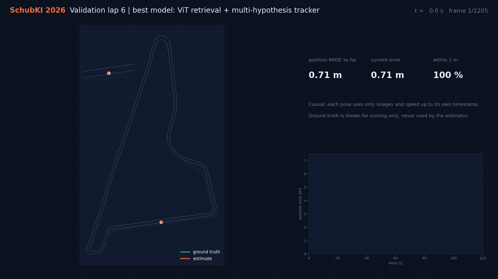
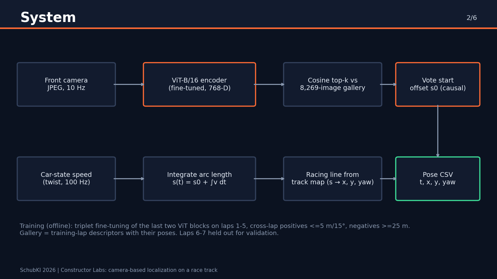
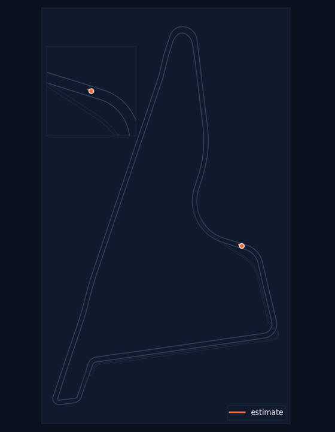

<div align="center">

# Camera-only race-car localization at 245 km/h

**SchubKI 2026 · Constructor Labs challenge · Yas Marina Circuit**

Causal 10 Hz pose estimation (x, y, yaw) from onboard camera images, the track map and car-state speed.<br>
No GNSS, LiDAR, IMU or ground truth at inference.

**[Slides (PDF, 6)](docs/slides.pdf)** · **[Video (4:54, subtitled)](docs/demo_video.mp4)** · **[Test poses](results/test_poses.csv)** · **[Validation scores](results/)** · **[Model weights](https://github.com/LivingPixel-pixel/SchubKI2026-camera-localization/releases/tag/v1.0-submission)**



*Best model on held-out validation lap 6: causal estimate (orange) vs ground truth (green), running error on the right.*

</div>

## Team

Tim Roth · Mohamed Lebdah · Kende Daniel Rethelyi · Rohel Shrestha · Jonas Klupsch

## Results at a glance

| | Position RMSE | Lateral RMSE | Heading RMSE | Within 1 m | Coverage | Runtime |
|---|---:|---:|---:|---:|---:|---:|
| **Best model, validation lap 6** | **1.79 m** | **0.63 m** | **0.79°** | **69 %** | 100 % | 76 ms/frame |
| **Best model, validation lap 7** | **1.83 m** | **0.83 m** | **1.02°** | **63 %** | 100 % | 76 ms/frame |
| Earlier team baseline (laps 4-5) | 15.0 m | 1.54 m | 1.37° | 39 % | 100 % | 72 ms/frame |

Scores are the unmodified output of the organizers' `evaluate.py` ([lap 6](results/validation_lap6_score_motion_tracker.txt), [lap 7](results/validation_lap7_score_motion_tracker.txt)).
Runtime: AMD Ryzen AI 7 350 laptop, Radeon 860M iGPU (DirectML), 32 GB RAM. About 13 Hz, faster than the 10 Hz camera.

## How it works



1. **Learned place recognition.** A ViT-B/16 (ImageNet init) is fine-tuned with triplet loss on training laps 1-5: positives are
   other laps within 5 m and 15°, negatives at least 25 m away, plus static hard negatives. Only the last two transformer
   blocks train, which fits a laptop GPU. Code: [`training/backend/race_localization/vit_hour_finetune.py`](training/backend/race_localization/vit_hour_finetune.py).
2. **Gallery.** 768-D descriptors of 8,269 front-left training images with their poses.
3. **Causal tracking.** Every frame retrieves the top-k gallery places. Car-state twist predicts motion between frames.
   - Best model, [`motion_tracker.py`](localizer/motion_tracker.py): several pose hypotheses are seeded from distinct retrievals, propagated with twist,
     corrected by gated matches (12 m, 35°) and scored causally; the best hypothesis is emitted. No first pose needed.
   - Robust variant, [`track_odometry.py`](localizer/track_odometry.py): arc length `s(t) = s0 + ∫v dt` along the racing line,
     with the start offset `s0` voted by retrieval. Cannot jump off the track.

Every pose uses only images and speed up to its own timestamp.

## Hidden test run

<table><tr>
<td></td>
<td>

- 739 frames, 74 s, one full lap in **daylight** at up to **68 m/s**; training data is night only.
- Under this domain shift pure retrieval jumps between similar straights, so the submitted test poses use the
  **track-odometry** variant (validation 1.97-2.64 m, lateral 1.26-1.35 m), which stays continuous.
- 739/739 frames emitted (100 % coverage), no first pose used.
- File: [`results/test_poses.csv`](results/test_poses.csv) with columns `timestamp,x,y,yaw,confidence,status` (timestamp = image header stamp in ns, track frame; confidence = share of retrieval votes behind the emitted lap position, scaled to 0-1; status `lost` when that share is below 5 %). Same poses in the official scorer format: [`results/test_poses_scorer_format.csv`](results/test_poses_scorer_format.csv). Run metadata: [`results/test_poses.run.json`](results/test_poses.run.json).

</td></tr></table>

## Latest team result: wide-view 5-crop matching (not yet in the submitted poses)

Same step-7750 weights, inference only: each frame is encoded as 5 overlapping crops across the full image width, and
similarity is the best mean crop cosine over horizontal shifts of -2..2 crops, which absorbs yaw and lateral offset.
On the lap-3 retrieval benchmark (gallery laps 1-2, 1,236 queries) Recall@1 rose from **822 to 888 (66.5 % to 71.8 %)**,
Recall@5 from 901 to 956, and distant false matches fell from 53 to 40.
These are retrieval proxies chosen among about 16 variants on lap 3, not official pose scores. It costs 5 encoder passes per
frame, so it was not integrated into the real-time pipeline before the deadline. Details: [docs/VIT_MULTICROP_MATCHING.md](docs/VIT_MULTICROP_MATCHING.md),
code: [`training/backend/tools/eval_vit_multicrop.py`](training/backend/tools/eval_vit_multicrop.py) (CUDA).
## Reproduce

The competition data is licensed for the hackathon only, so it is **not** in this repository. Point the scripts at your copy of the dataset:

```powershell
python -m pip install -r requirements.txt
# 1. weights (343 MB) from the release into models/vit7750/
gh release download v1.0-submission -R LivingPixel-pixel/SchubKI2026-camera-localization -D models/vit7750
# 2. gallery from the raw training run (laps 1-5) using the official ground-truth export of the starter kit
python DATASET/tools/extract_gt.py DATASET/c0_2026-10-13_22-53-42_camloc_0.mcap gt.csv
python localizer/build_gallery.py DATASET/c0_2026-10-13_22-53-42_camloc_0.mcap gt.csv models/vit7750/gallery-laps1-5.npz
# 3. poses for a run: camera mcap + organizer map.mcap (racing line, from the 23-00-38_cut_120m_update package)
.\run_submission.ps1 -Mcap TEST.mcap -Map map.mcap          # Linux: ./run_submission.sh TEST.mcap map.mcap
```

Verified: `build_gallery.py` rebuilt from the raw training mcap reproduces the submitted gallery exactly
(8,269 images, identical timestamps and poses, descriptor cosine ≥ 0.9999999).
Validation: `localizer/kiro_localize.py validate`, `localizer/validate_motion_tracker.py`, `localizer/validate_track.py`, plots via `localizer/score_and_plot.py`.
Without a GPU it falls back to CUDA or CPU automatically.

## Failure cases and limits

- **Night to day.** Descriptors trained at night match wrong but similar straights in daylight. Fix ideas: lighting augmentation, multi-camera descriptors.
- **Repetitive straights** dominate the longitudinal error (1.1-2.3 m RMSE).
- **Validation speed proxy.** The training run has no twist topic, so validation uses speed differentiated from ground-truth positions; the test run uses the real car-state twist. Laps 6-7 were seen in earlier team baselines: reserved validation, not pristine data.
- **Track odometry** assumes the car is near the racing line; its true lateral offset is not observed.
- A last 1-hour retraining run produced 0 updates (time budget spent on baseline encoding and pair mining before the time check). The submitted encoder is the earlier step-7750 fine-tune.

## Declarations

Pre-trained: torchvision ViT-B/16 ImageNet-1k (BSD-3). Libraries: PyTorch, torchvision, torch-directml, NumPy, Pillow, mcap, matplotlib.
Data: Constructor Labs hackathon dataset only, not redistributed. AI tools: OpenAI Codex and Kiro (Claude) for code generation and review;
the team is responsible for the result. Code: MIT ([LICENSE](LICENSE)).
